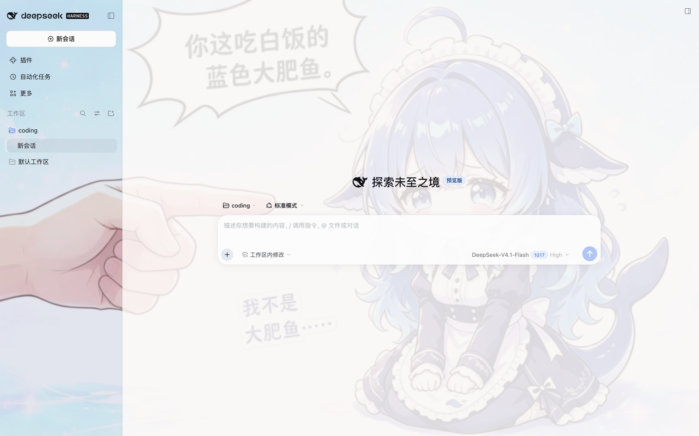

# dsh-theme-whalegirl

DeepSeek-鲸鱼娘 (Whale Girl) theme for the [DeepSeek Harness](https://github.com/deepseek-ai/deepseek-harness) (DSH) Web UI — ported from the DreamSkin skin package [`ver_cb557ececaa5de3f3dbe`](https://dreamskin.cc/themes/ver_cb557ececaa5de3f3dbe).

English | [中文](README.zh.md)



## What it does

- **Full token remap** — registers one light theme (`deepseek-whalegirl`) into DSH's native theme runtime with a complete `--dsw-*` dictionary (174 tokens): every surface, label, border, button, markdown block, scrollbar and state color derives from the DreamSkin palette.
- **Lightly frosted by default** — the whale-girl artwork sits as a fixed backdrop behind the UI, but since 0.2.0 the frosted glass is drastically toned down: app-frame blur drops from 18px to 4px and surfaces are far more opaque, keeping just a hint of the artwork.
- **User-adjustable glass & wallpaper** — frame blur, surface/bubble translucency, wallpaper veil, wallpaper visibility & blur and the composer focus glow are adjustable live from the plugin's card on the settings page (stored per browser), with three presets: 清爽玻璃 / DreamSkin 原味 / 纯净实底.
- **DreamSkin safe-css intent** — rounded sidebar, coffee-accent composer focus ring (toggleable), sand selection color, soft violet-tinted shadows.
- **Native integration** — the theme pins itself through `theme.setTheme()`; if the built-in Appearance scope resets the preference to *system*, the plugin re-asserts it. An explicit light/dark pick you make in Appearance wins until the plugin is toggled off/on again.

Palette anchors taken from the source skin:

| Role | Source value | Used for |
| --- | --- | --- |
| text | `#352970` | primary labels, ink ladder |
| highlight | `#455b78` | brand & primary buttons |
| accent | `#7a4e29` | composer focus ring |
| accentAlt | `#ceb683` | active nav accent, selection |
| secondary | `#85c1cc` | blue/info ladder |
| panel / panelAlt | `#abb4cf` / `#c3cee4` | periwinkle sidebar glass |
| background | `#bd9999` | rose paper tint, bubbles |

## Install

npm (recommended — versioned, easily upgradable, and no build step):

```sh
dsh plugin --profile web add -w dsh-theme-whalegirl
```

Or install from the [dsh-market](https://github.com/dsh-market/dsh-market) plugin's Themes tab (search "whalegirl").

Other sources:

```sh
# prebuilt tarball from GitHub Releases (use if the npm registry is unavailable)
dsh plugin --profile web add -w https://github.com/ZHOUcourier/dsh-theme-whalegirl/releases/latest/download/dsh-theme-whalegirl.tgz

# git (tracks main)
dsh plugin --profile web add -w github:ZHOUcourier/dsh-theme-whalegirl

# local checkout
dsh plugin --profile web add -w link:/path/to/dsh-theme-whalegirl
```

Then restart the profile:

```sh
dsh --profile web
```

The theme applies immediately once the plugin mounts. To switch away, pick a preference in Settings → General → Appearance (the plugin steps aside); to come back, toggle the plugin off/on in the market Themes tab.

## Customize

Open **Settings → the plugins page** and find the **「鲸鱼娘 · 玻璃与壁纸」** card. Every change applies instantly; values are stored in this browser's localStorage (`dsh-whalegirl.prefs.v1`), not in the profile.

| Control | Range | Default | Effect |
| --- | --- | --- | --- |
| Presets | — | 清爽玻璃 | One-click 清爽玻璃 / DreamSkin 原味 / 纯净实底 |
| 主框背景模糊 | 0–24px | 4px | App-frame backdrop blur radius (the old port was hard-coded 18px) |
| 表面透明度 | 0–100% | 45% | 0 = fully opaque surfaces, 100 = original translucent design |
| 用户气泡透明度 | 0–100% | 60% | Translucency of the dusty-rose user bubbles |
| 壁纸遮罩浓度 | 0–100% | 55% | Strength of the paper veil over the artwork |
| 显示环境壁纸 | on/off | on | Hides artwork + veil for a plain paper background |
| 壁纸模糊 | 0–16px | 0px | Softens the artwork itself |
| 输入框咖啡色聚焦光晕 | on/off | on | The DreamSkin composer focus ring |

**恢复默认** restores the defaults above. Upgrading from 0.1.x starts from the new (lighter) defaults; nothing is migrated.

Uninstall:

```sh
dsh plugin --profile web remove dsh-theme-whalegirl
```

## Compatibility

- Requires a DSH web client profile (`dsh.client.platform: "web"`, client bundle via `exports["./client"]`).
- DSH 0.1.6+ / strict Cordis: the client declares `inject: ["theme", "slots"]`, so the settings card's `ctx.slots` access is legal, and every service probe falls back to `ctx.get()` instead of throwing. A host without the slots service still gets the full theme — only the optional settings card is skipped.
- Light appearance only — faithful to the source skin, which ships one light palette.
- Works alongside other plugins; nothing outside the gated body attribute `data-dsh-whalegirl` is touched when disabled.

## Development

```sh
npm run build   # wrap src/client.js into lib/client.js + embed assets/background.jpg
npm test        # smoke test: register/guard/dispose against a mocked DOM
npm run check   # verify lib/ matches src/ (CI)
```

The build is dependency-free (plain Node). `lib/` is committed so installs never need a build step.

## Credits

- Theme artwork & palette: [DeepSeek-鲸鱼娘](https://dreamskin.cc/themes/ver_cb557ececaa5de3f3dbe) on [DreamSkin](https://dreamskin.cc).
- Plugin shape follows the official [`dsh.bundle`](https://github.com/awesome-dsh-plugin/awesome-dsh-plugin) manifest convention.

## License

[MIT](LICENSE). The bundled artwork comes from the DreamSkin package linked above; all rights of the original artwork remain with its author.
