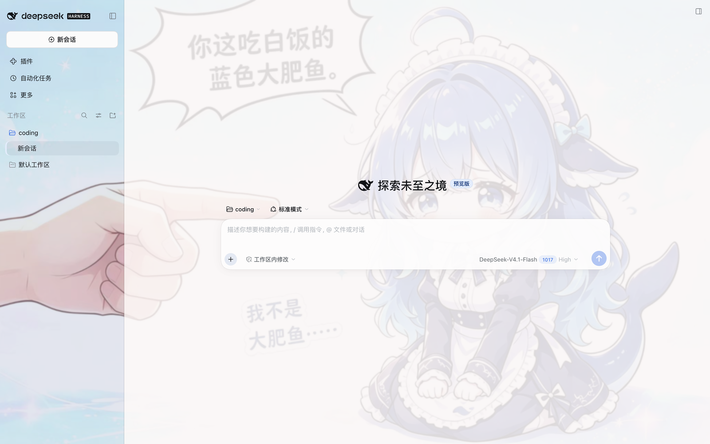
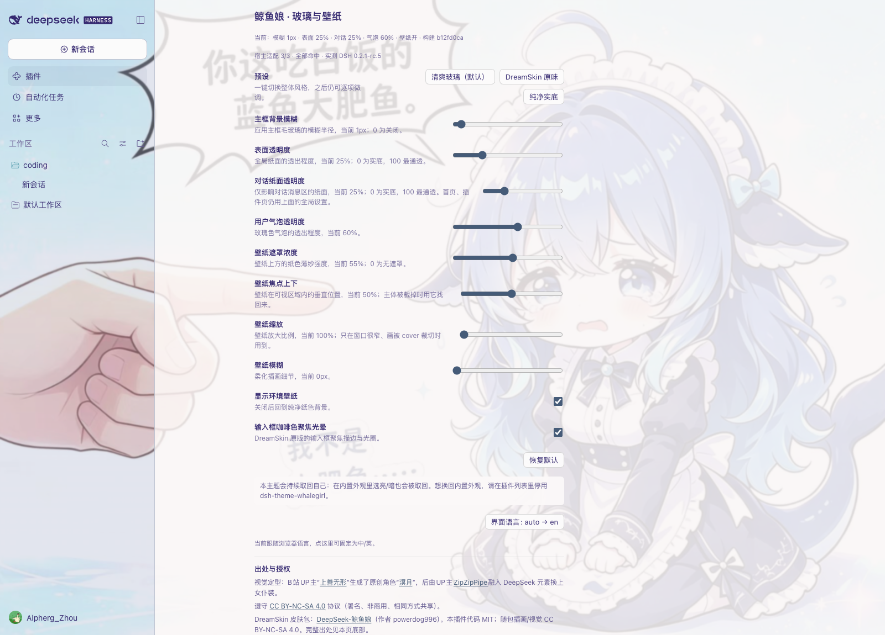

# dsh-theme-whalegirl

[](https://github.com/ZHOUcourier/dsh-theme-whalegirl/actions/workflows/ci.yml)
[](https://www.npmjs.com/package/dsh-theme-whalegirl)
[](CREDITS.md)

DeepSeek-鲸鱼娘 (Whale Girl) theme for the [DeepSeek Harness](https://github.com/deepseek-ai/deepseek-harness) (DSH) Web UI — a native light theme built from the DreamSkin palette, with the whale-girl artwork behind a light paper layer and live glass, wallpaper and conversation-paper controls.

English | [中文](README.zh.md)




> **Artwork credit.** The original character 溟月 (Mingyue) was created by Bilibili creator 上善无形; Bilibili creator ZipZipPipe later combined her with DeepSeek elements and the maid outfit. The artwork is licensed [CC BY-NC-SA 4.0](https://creativecommons.org/licenses/by-nc-sa/4.0/) (attribution, non-commercial, share-alike) and is **not** covered by the plugin's MIT license. The DreamSkin package was published by powerdog996. Full credits: [CREDITS.md](CREDITS.md).

## What it does

- **Full token remap** — registers one light theme (`deepseek-whalegirl`) into DSH's native theme runtime with a complete `--dsw-*` dictionary (174 tokens): every surface, label, border, button, markdown block, scrollbar and state color derives from the DreamSkin palette.
- **Light paper, not heavy frost** — the whale-girl artwork sits as a fixed backdrop behind the UI. Since 0.2.x the app-frame blur is 1px by default and the main column carries a single paper layer, so about 14% of the artwork reads through while body text keeps its contrast.
- **Conversation-only paper opacity** — since 0.3.0 a separate slider controls the transcript column only. Long chats can show more wallpaper without making the home page, menus or plugin pages more translucent; those keep the global surface setting.
- **Settings on the installed package page** — the form is contributed as the bundle's own configuration (`plugins.bundle.config`), so it appears on **Plugins → Installed → dsh-theme-whalegirl**, above the component list. It is no longer part of the built-in configuration cards.
- **Adjustable glass & wallpaper** — frame blur, global surface and bubble translucency, conversation paper, wallpaper veil, visibility, focus, zoom and blur, and the composer focus glow are adjustable live, with three presets: 清爽玻璃 / DreamSkin 原味 / 纯净实底. The card follows the host UI language and can be pinned to 中文 or English.
- **Native integration** — the theme pins itself through `theme.setTheme()` and a `theme/change` guard re-asserts it whenever anything else writes another preference. That includes an explicit light/dark pick in Appearance, because the desktop shell writes exactly that when it adopts its stored settings after plugins mount: **the way back to the built-in appearance is to disable this plugin**, in the market Themes tab or on its installed-package page. The settings card says the same thing where you would look for it.
- **Two stylesheet layers** — the token palette and the wallpaper bytes live in a static layer written once per mount; only the few declarations the sliders move are rewritten on adjustment, so dragging a control costs ~4 KB instead of re-parsing the ~0.4 MB wallpaper.
- **Self-reporting compatibility** — the paper model depends on host class names that a refactor can rename, so the plugin probes them and prints `宿主适配 3/3 · 实测 DSH 0.2.1-rc.5` on the settings card, naming any miss in the console as well.
- **Light appearance only** — faithful to the source skin, which ships one light palette.

Palette anchors taken from the source skin:

| Role | Source value | Used for |
| --- | --- | --- |
| text | `#352970` | primary labels, ink ladder |
| highlight | `#455b78` | brand & primary buttons |
| accent | `#7a4e29` | composer focus ring |
| accentAlt | `#ceb683` | active nav accent, selection |
| secondary | `#85c1cc` | blue/info ladder |
| panel / panelAlt | `#abb4cf` / `#c3cee4` | periwinkle sidebar glass |
| background | `#bd9999` | rose paper tint, bubbles |

## Install

npm (recommended — versioned, easily upgradable, and no build step):

```sh
dsh plugin --profile web add -w dsh-theme-whalegirl
```

Or install from the [dsh-market](https://github.com/dsh-market/dsh-market) plugin's Themes tab (search "whalegirl").

Other sources:

```sh
# prebuilt tarball from GitHub Releases (use if the npm registry is unavailable)
dsh plugin --profile web add -w https://github.com/ZHOUcourier/dsh-theme-whalegirl/releases/latest/download/dsh-theme-whalegirl.tgz

# git (tracks main)
dsh plugin --profile web add -w github:ZHOUcourier/dsh-theme-whalegirl

# local checkout
dsh plugin --profile web add -w link:/path/to/dsh-theme-whalegirl
```

Then restart the profile:

```sh
dsh --profile web
```

The theme applies immediately once the plugin mounts. While the plugin is enabled it owns the appearance: a light/dark pick in Settings → General → Appearance is reclaimed, because the same write happens on the desktop's own cold start. To switch back to the built-in appearance, disable the plugin (market Themes tab, or its installed-package page); toggling it on again brings the theme back.

## Settings

Open **Plugins → Installed → dsh-theme-whalegirl** and use the **「鲸鱼娘 · 玻璃与壁纸」** form. Every change applies instantly; values are stored in this browser's localStorage (`dsh-whalegirl.prefs.v2`), not in the profile.

| Control | Range | Default | Effect |
| --- | --- | --- | --- |
| Presets | — | 清爽玻璃 | One-click 清爽玻璃 / DreamSkin 原味 / 纯净实底 |
| 主框背景模糊 | 0–24px | 1px | App-frame backdrop blur radius; 0 = off |
| 表面透明度 | 0–100% | 25% | Global paper opacity (home, menus, plugin pages); 0 = solid, 100 = most open (~55%) |
| 对话纸面透明度 | 0–100% | 25% | Conversation transcript only; 0 = solid, 100 = most open (~45% paper) |
| 用户气泡透明度 | 0–100% | 60% | Translucency of the dusty-rose user bubbles |
| 壁纸遮罩浓度 / Wallpaper veil | 0–100% | 55% | Strength of the paper veil over the artwork |
| 显示环境壁纸 / Show wallpaper | on/off | on | Hides artwork + veil for a plain paper background |
| 壁纸焦点上下 / Wallpaper focus | 0–100% | 50% | Vertical position of the artwork, for windows whose crop cuts the subject off |
| 壁纸缩放 / Wallpaper zoom | 100–200% | 100% | Scale of the artwork, for narrow windows where `cover` crops hard |
| 壁纸模糊 / Wallpaper blur | 0–16px | 0px | Softens the artwork itself |
| 输入框咖啡色聚焦光晕 / Focus glow | on/off | on | The DreamSkin composer focus ring |
| 界面语言 / Language | auto → zh → en | auto | Card copy follows the **host UI** language (`<html lang>`), with the browser language only as a fallback; pin it here |

The card header also prints the current values, the stylesheet build id, and the host-hook report (`宿主适配 3/3 · 实测 DSH 0.2.1-rc.5`).

**恢复默认 / Restore defaults** restores the defaults above. Upgrading from 0.1.x starts from the new (lighter) defaults; nothing is migrated.

Uninstall:

```sh
dsh plugin --profile web remove dsh-theme-whalegirl
```

## Compatibility

- Requires a DSH web client profile (`dsh.client.platform: "web"`, client bundle via `exports["./client"]`).
- DSH `>= 0.1.6` is declared in `engines.dsh`; tested on DSH 0.2.1-rc.5. The client declares `inject: ["theme", "slots"]`, so the settings form's `ctx.slots` access is legal and every service probe falls back to `ctx.get()` instead of throwing. A host without the slots service still gets the full theme; only the optional settings entry is skipped.
- No upper bound is declared on purpose: the theme is visual-only, and a false ceiling would hide it from newer hosts that in fact work. What a real breakage does is drop the hook report on the settings card to `宿主适配 2/3` and log the missing selector — please paste that line into an issue.
- Light appearance only — the source skin ships one light palette.
- Works alongside other plugins; nothing outside the gated body attribute `data-dsh-whalegirl` is touched when disabled.

### Paper model

The host's surface ownership differs per shell: the macOS titlebar layout gives the center/right columns `--dsw-alias-bg-base`, while the browser layout paints no column background and lets each page (conversation root, dock tab host) paint it. The skin owns the column surface itself: `[class*="_centerCol"]`/`[class*="_rightbarCol"]` carry the paper on every platform, the conversation root and `[class*="_tabHost"]` stay transparent, so every page has exactly one paper layer (~86% opaque at the default, ~14% wallpaper). The sidebar paints the same token twice (the layout column and the sidebar's own `_root`); the skin blanks the inner fill and paints the wash once from the column.

Since 0.3.0, `[class*="_centerCol"]:has([data-slot="conversation.header"])` re-emits `--dsw-alias-bg-base` with the conversation-only value. The right sidebar, home, menus and plugin pages keep the global `表面透明度`.

## Development

```sh
npm run build        # wrap src/client.js into lib/client.js + embed assets/background.jpg
npm test             # smoke test: register/guard/card/dispose against a mocked DOM
npm run check        # verify lib/ matches src/ (CI)
npm run test:browser -- --url "http://127.0.0.1:5190/?token=…"   # real Chromium, computed styles
```

The build is dependency-free (plain Node). `lib/` is committed so installs never need a build step.

`npm test` proves the plugin's logic; it cannot see the things that actually broke in the past (two paper layers composing to ~99% white, the web sidebar rendering solid where the desktop showed the wallpaper, a cold-start presenter overwriting the palette). `npm run test:browser` boots a real DSH web profile and asserts computed styles instead of strings: the label colour lands on `#352970`, the wallpaper paints behind a single translucent column (alpha ≈ 0.86 at the default, ≈ 0.48 at 95%), preferences survive a reload, and no page error is raised. Boot any profile for it — a throwaway one keeps your own clean:

```sh
dsh --profile whalecheck --from-default-profile web --dump-config   # create without booting
dsh plugin --profile whalecheck add -w link:"$PWD"
dsh --profile whalecheck --no-open --port 5190                      # prints the token URL
```

Playwright is resolved from a local install, `npm root -g`, or the npx cache; if its Chromium was never downloaded the script falls back to the system Chrome.

## Credits & license

### Visual identity

视觉定型：B站UP主[“上善无形”](https://www.bilibili.com/opus/1231977657712771073)生成了原创角色[“溟月”](https://www.bilibili.com/opus/1231977657712771073)，后由UP主[ZipZipPipe](https://space.bilibili.com/4168597/)融入DeepSeek元素换上女仆装。遵守 [CC BY-NC-SA 4.0](https://creativecommons.org/licenses/by-nc-sa/4.0/deed.zh-hans) 协议（署名、非商用、相同方式共享）。

Visual identity: the original character Mingyue (溟月) was created by Bilibili creator 上善无形; Bilibili creator ZipZipPipe later combined her with DeepSeek elements and the maid outfit. The visual is licensed under CC BY-NC-SA 4.0 (attribution, non-commercial, share-alike).

### DreamSkin source

The theme was ported from the DreamSkin package [DeepSeek-鲸鱼娘 `ver_cb557ececaa5de3f3dbe`](https://dreamskin.cc/themes/ver_cb557ececaa5de3f3dbe) by **powerdog996**. That page lists the package as MIT; this plugin treats that MIT as covering the DreamSkin package's packaging/code, while the character and artwork remain under the original CC BY-NC-SA 4.0 terms. See [CREDITS.md](CREDITS.md) for the full chain and the license split.

### License

- **Code** — MIT. See [LICENSE](LICENSE).
- **Artwork & visual identity** — CC BY-NC-SA 4.0; attribution, non-commercial, share-alike. See [CREDITS.md](CREDITS.md).
- MIT does not cover the bundled artwork (`assets/background.jpg`, derived character layers, previews, icons); CC does not cover the plugin code.

## Release notes

See [CHANGELOG.md](CHANGELOG.md) or [GitHub Releases](https://github.com/ZHOUcourier/dsh-theme-whalegirl/releases) for the changes in each version.
