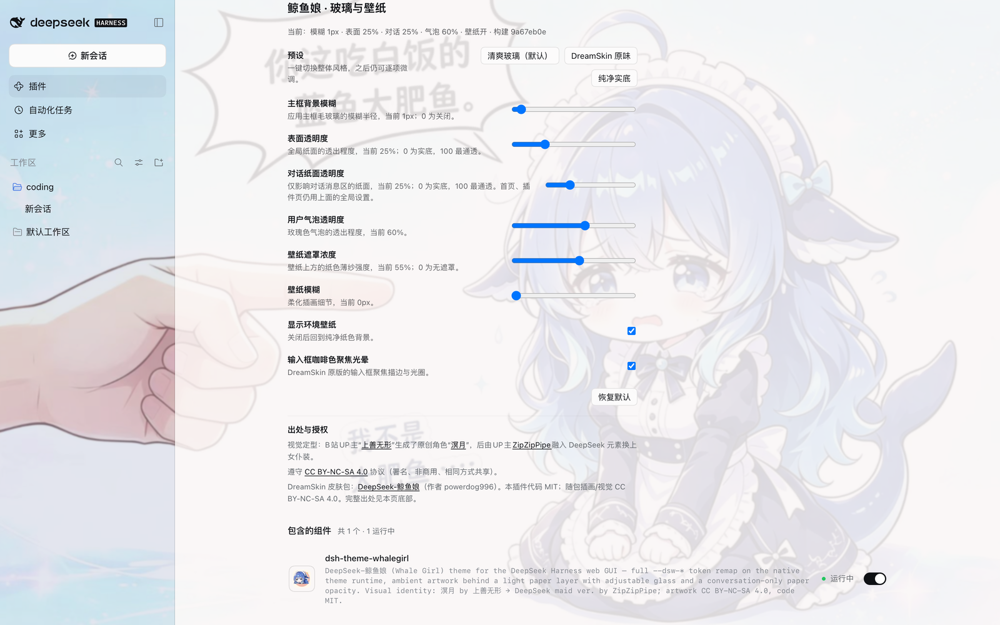

# dsh-theme-whalegirl

DeepSeek-鲸鱼娘主题，面向 [DeepSeek Harness](https://github.com/deepseek-ai/deepseek-harness)（DSH）Web UI。以 DreamSkin 调色板注册原生亮色主题，鲸鱼娘插画衬在轻纸面之后，玻璃、壁纸与对话纸面均可实时调节。

[English](README.md) | 中文




> **插画出处。** 原创角色“溟月”由 B 站 UP 主[上善无形](https://www.bilibili.com/opus/1231977657712771073)创作；后由 UP 主 [ZipZipPipe](https://space.bilibili.com/4168597/) 融入 DeepSeek 元素并换上女仆装。插画采用 [CC BY-NC-SA 4.0](https://creativecommons.org/licenses/by-nc-sa/4.0/deed.zh-hans)（署名、非商用、相同方式共享），**不**适用本插件的 MIT 代码许可。DreamSkin 皮肤包由 powerdog996 发布。完整说明见 [CREDITS.md](CREDITS.md)。

## 功能

- **完整令牌重映射** —— 在 DSH 原生主题系统注册一套亮色主题（`deepseek-whalegirl`），携带完整的 `--dsw-*` 令牌字典（174 个）：表面、文字、边框、按钮、代码块、滚动条、状态色的每一档都由 DreamSkin 调色板推导。
- **轻纸面，而不是厚磨砂** —— 鲸鱼娘插画作为固定背景衬在界面之后；0.2.x 起主框默认模糊为 1px，主区域只保留一层纸面，默认约 14% 壁纸透出，正文对比度不受影响。
- **对话纸面独立调节** —— 0.3.0 新增一个只作用于对话消息列的滑杆。长对话可以透出更多壁纸，而首页、菜单和插件页仍使用全局表面设置。
- **设置位于已安装插件页** —— 设置表单以 bundle 自身配置（`plugins.bundle.config`）注册，出现在 **插件 → 已安装 → dsh-theme-whalegirl** 的组件列表上方，不再占用“内置插件配置”栏目。
- **玻璃与壁纸可调** —— 主框模糊、全局表面/气泡透明度、对话纸面、壁纸遮罩、壁纸显示与模糊、输入框聚焦光晕均可实时调节，并附带三套预设：清爽玻璃 / DreamSkin 原味 / 纯净实底。
- **原生集成** —— 通过 `theme.setTheme()` 固定主题；若内置外观设置把它重置为“系统”，插件会重新声明。你在外观里明确选择的亮/暗模式优先，直到关闭再开启插件。
- **仅亮色外观** —— 忠实还原源皮肤的单套亮色调色板。

调色板锚点来自源皮肤：

| 角色 | 源值 | 用途 |
| --- | --- | --- |
| text | `#352970` | 主文字、墨色阶梯 |
| highlight | `#455b78` | 品牌色与主按钮 |
| accent | `#7a4e29` | 输入框聚焦描边 |
| accentAlt | `#ceb683` | 导航选中强调、文本选中 |
| secondary | `#85c1cc` | 蓝色/信息阶梯 |
| panel / panelAlt | `#abb4cf` / `#c3cee4` | 长春花侧栏玻璃 |
| background | `#bd9999` | 玫瑰纸色、气泡 |

## 安装

npm（推荐——有版本号、可直接升级、无需构建）：

```sh
dsh plugin --profile web add -w dsh-theme-whalegirl
```

也可以在 [dsh-market](https://github.com/dsh-market/dsh-market) 的 Themes 标签里搜索 “whalegirl” 安装。

其他来源：

```sh
# GitHub Release 预构建包（npm registry 不可用时使用）
dsh plugin --profile web add -w https://github.com/ZHOUcourier/dsh-theme-whalegirl/releases/latest/download/dsh-theme-whalegirl.tgz

# git 仓库（跟随 main）
dsh plugin --profile web add -w github:ZHOUcourier/dsh-theme-whalegirl

# 本地目录
dsh plugin --profile web add -w link:/path/to/dsh-theme-whalegirl
```

安装后重启 profile：

```sh
dsh --profile web
```

插件挂载后主题立即生效。想换回内置外观：在外观设置里选择偏好即可（插件会让位）；想再次启用：在市场 Themes 标签里关闭再开启插件。

## 设置

打开 **插件 → 已安装 → dsh-theme-whalegirl**，使用 **「鲸鱼娘 · 玻璃与壁纸」** 表单。所有改动即时生效，保存在当前浏览器的 localStorage（`dsh-whalegirl.prefs.v2`），不写入 profile。

| 控件 | 范围 | 默认 | 作用 |
| --- | --- | --- | --- |
| 预设 | — | 清爽玻璃 | 一键切换 清爽玻璃 / DreamSkin 原味 / 纯净实底 |
| 主框背景模糊 | 0–24px | 1px | 应用主框背景模糊；0 为关闭 |
| 表面透明度 | 0–100% | 25% | 全局纸面（首页、菜单、插件页）；0 为实底，100 最通透（约 55% 纸面） |
| 对话纸面透明度 | 0–100% | 25% | 仅对话消息区；0 为实底，100 最通透（约 45% 纸面） |
| 用户气泡透明度 | 0–100% | 60% | 玫瑰色用户气泡的透出程度 |
| 壁纸遮罩浓度 | 0–100% | 55% | 壁纸上方纸色薄纱的强度 |
| 显示环境壁纸 | 开/关 | 开 | 关闭后回到纯净纸色背景 |
| 壁纸模糊 | 0–16px | 0px | 柔化插画本身 |
| 输入框咖啡色聚焦光晕 | 开/关 | 开 | DreamSkin 原版输入框聚焦描边 |

**恢复默认** 会恢复上表默认值。从 0.1.x 升级会直接使用新的轻纸面默认值，不做迁移。

卸载：

```sh
dsh plugin --profile web remove dsh-theme-whalegirl
```

## 兼容性

- 需要 DSH web 客户端 profile（`dsh.client.platform: "web"`，客户端入口经 `exports["./client"]` 暴露）。
- `engines.dsh` 声明为 `>= 0.1.6`，已在 DSH 0.2.1-rc.3 实测。客户端声明 `inject: ["theme", "slots"]`，设置表单读取 `ctx.slots` 合法；所有服务探测失败时回退到 `ctx.get()`，不会抛异常。即使宿主没有 slots 服务，主题仍完整应用，只是跳过可选的设置入口。
- 仅提供亮色外观——忠实还原源皮肤的单套亮色调色板。
- 与其他插件共存；禁用时不触碰任何东西，只依赖受控的 body 属性 `data-dsh-whalegirl`。

### 纸面模型

宿主的纸面归属在不同外壳下并不一致：macOS 标题栏布局只给中心列/右侧列 `--dsw-alias-bg-base`，浏览器布局则完全不画列背景，改由页面自己（会话根、dock 的 tab host）上纸。主题因此自己接管列表面：`[class*="_centerCol"]`/`[class*="_rightbarCol"]` 在所有平台都铺一层纸，会话根与 `[class*="_tabHost"]` 保持透明，任何页面都恰好只有一层纸面（默认档约 86% 不透明，约 14% 壁纸透出）。侧边栏也有两层在铺同一个令牌（布局列与侧边栏自己的 `_root`）；主题在列内清空内层填充，再由列统一上一次 wash。

0.3.0 起，`[class*="_centerCol"]:has([data-slot="conversation.header"])` 会用“对话纸面透明度”重设 `--dsw-alias-bg-base`；右侧栏、首页、菜单和插件页继续使用全局“表面透明度”。

## 开发

```sh
npm run build   # 将 src/client.js 包装为 lib/client.js 并内嵌 assets/background.jpg
npm test        # 冒烟测试：对 mock DOM 走一遍 register/guard/dispose
npm run check   # 校验 lib/ 与 src/ 一致（CI 用）
```

构建零依赖（纯 Node）。`lib/` 已提交入库，安装方无需执行任何构建。

## 出处与许可

### 视觉出处

视觉定型：B站UP主[“上善无形”](https://www.bilibili.com/opus/1231977657712771073)生成了原创角色[“溟月”](https://www.bilibili.com/opus/1231977657712771073)，后由UP主[ZipZipPipe](https://space.bilibili.com/4168597/)融入DeepSeek元素换上女仆装。遵守 [CC BY-NC-SA 4.0](https://creativecommons.org/licenses/by-nc-sa/4.0/deed.zh-hans) 协议（署名、非商用、相同方式共享）。

### DreamSkin 原出处

本主题移植自 powerdog996 发布在 DreamSkin 的 [DeepSeek-鲸鱼娘 `ver_cb557ececaa5de3f3dbe`](https://dreamskin.cc/themes/ver_cb557ececaa5de3f3dbe)。该页面把皮肤包标为 MIT；本插件把该 MIT 仅视为其打包/代码部分的许可，角色与插画仍按原作者的 CC BY-NC-SA 4.0 处理。完整链条与许可拆分见 [CREDITS.md](CREDITS.md)。

### 许可

- **代码** —— MIT，见 [LICENSE](LICENSE)。
- **插画与视觉** —— CC BY-NC-SA 4.0；署名、非商用、相同方式共享，见 [CREDITS.md](CREDITS.md)。
- MIT 不覆盖随包插画（`assets/background.jpg`、派生角色图层、预览图、图标）；CC 不覆盖插件代码。

## 发布说明

各版本改动见 [GitHub Releases](https://github.com/ZHOUcourier/dsh-theme-whalegirl/releases)。
